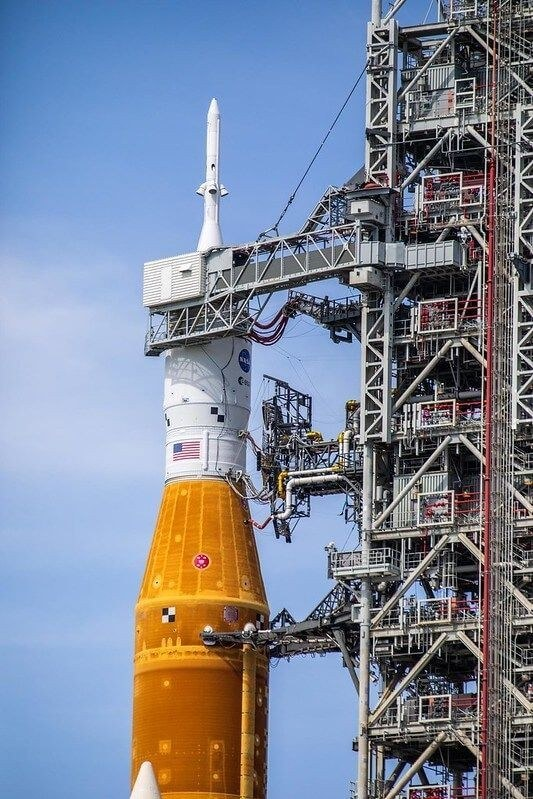
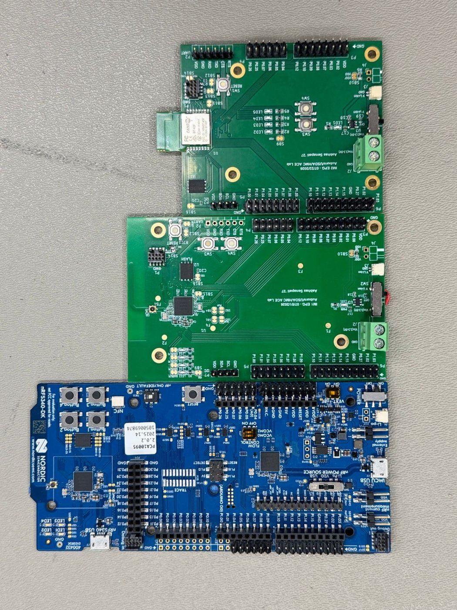
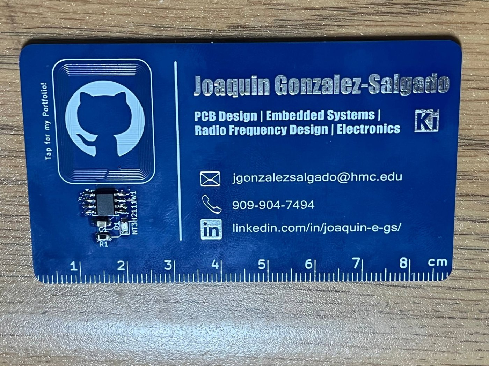
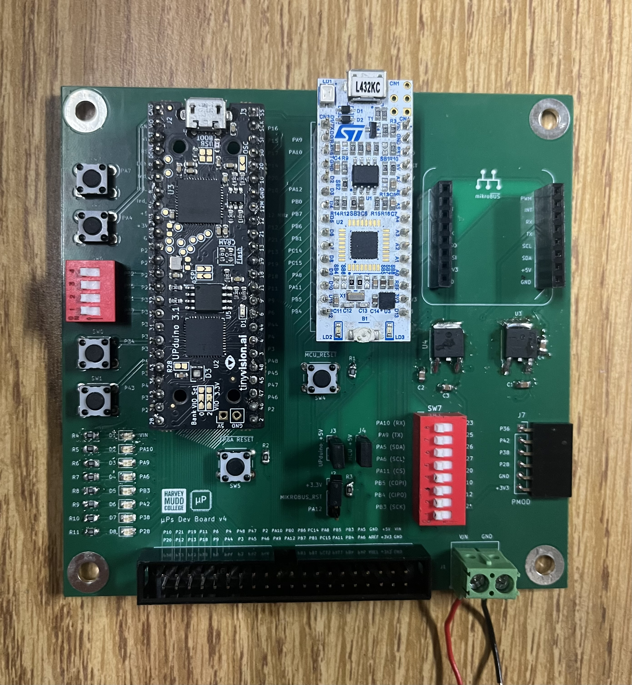
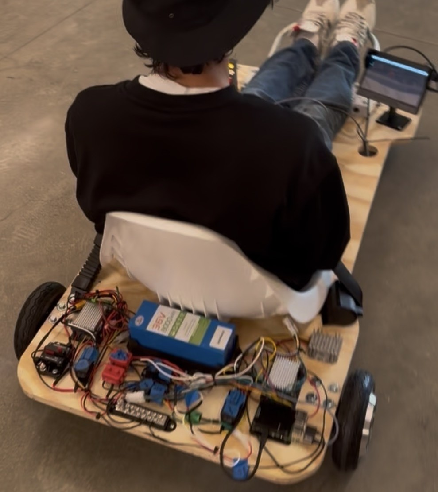
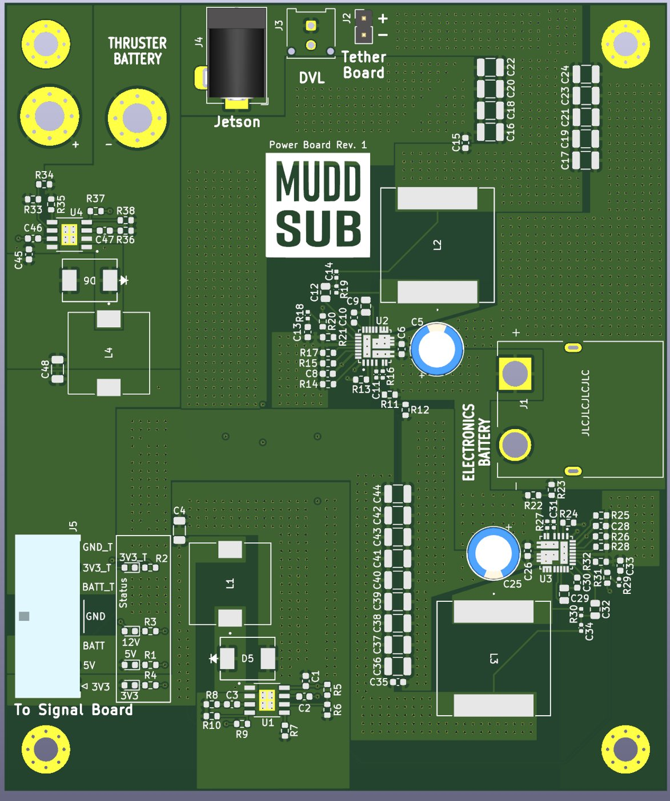
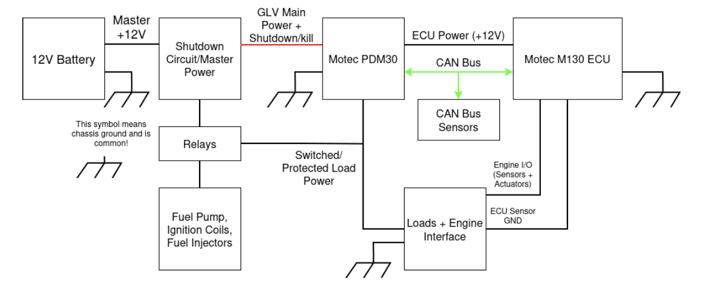
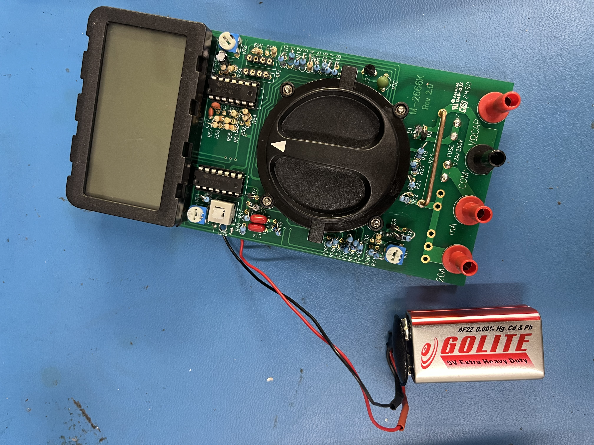

```{=html}
<section class="hero">
  <div class="hero-text">
    <span class="eyebrow"><a href="https://www.hmc.edu/" target="_blank">Harvey Mudd College</a> / B.S. Electrical &amp; Computer Engineering / 2028</span>
    <h1 class="hero-name">Joaquin Gonzalez-Salgado</h1>
    <div class="chip-row">
      <span class="chip">Analog Design</span>
      <span class="chip">PCB Layout &amp; Bring-Up</span>
      <span class="chip">RF Circuits</span>
      <span class="chip">FPGA / MCU</span>
    </div>
    <div class="hero-actions">
      <a class="btn btn-primary" href="images/Resume.pdf" target="_blank">View Resume</a>
      <a class="btn btn-outline" href="#featured-work">See Projects</a>
      <span class="icon-links">
        <a class="btn btn-outline btn-icon" href="mailto:jgonzalezsalgado@hmc.edu" title="Email" aria-label="Email"><i class="bi bi-envelope-fill"></i></a>
        <a class="btn btn-outline btn-icon" href="tel:+19099047494" title="Phone" aria-label="Phone"><i class="bi bi-telephone-fill"></i></a>
        <a class="btn btn-outline btn-icon" href="https://www.linkedin.com/in/joaquin-e-gs/" target="_blank" title="LinkedIn" aria-label="LinkedIn"><i class="bi bi-linkedin"></i></a>
        <a class="btn btn-outline btn-icon" href="https://github.com/jgonzs" target="_blank" title="GitHub" aria-label="GitHub"><i class="bi bi-github"></i></a>
      </span>
    </div>
  </div>
  <div class="hero-photo">
    
  </div>
</section>
```

## Current Work

```{=html}
<div class="now-grid">
  <div class="now-item">
    <div class="now-label">Incoming · Jan. 2027</div>
    <p><a href="https://www.stratarobot.com/careers" target="_blank"><strong>Strata Robotics</strong></a>: electrical &amp; firmware intern on V1 bring-up of an outdoor construction robot.</p>
  </div>
  <div class="now-item">
    <div class="now-label">Industry</div>
    <p><a href="experience.html#blue-origin"><strong>Blue Origin</strong></a>: validating a multi-sensor suite for automated umbilical-panel mating.</p>
  </div>
  <div class="now-item">
    <div class="now-label">Research</div>
    <p><a href="research.html"><strong>Analog Circuit Lab</strong></a>: low-noise analog front ends and Zephyr firmware for USDA instruments.</p>
  </div>
  <div class="now-item">
    <div class="now-label">Building</div>
    <p><a href="e155.html#ir-laser-tag"><strong>IR laser tag</strong></a>: iCE40 FPGA encodes 38&nbsp;kHz IR packets and signals hits to an STM32 over SPI.</p>
  </div>
</div>
```

## Featured Work

```{=html}
<div class="card-grid">
  <a class="work-card" href="experience.html#blue-origin">
    <div class="thumb"></div>
    <div class="body">
      <span class="tag">Industry · Blue Origin</span>
      <h3>Umbilical Panel Validation</h3>
      <p>Redundant radar, LiDAR, IMU, and vision sensors with Kalman filtering to align umbilical panels in 6 DOF to about 0.1&nbsp;mm.</p>
    </div>
  </a>
  <a class="work-card" href="research.html">
    <div class="thumb"></div>
    <div class="body">
      <span class="tag">Research · Analog Circuit Lab</span>
      <h3>USDA Electropenetrograph</h3>
      <p>Analog front ends with up to 7,000x gain, single-supply battery management, and nRF5340 Bluetooth firmware on Zephyr.</p>
    </div>
  </a>
  <a class="work-card" href="pcb.html#nfc-business-card">
    <div class="thumb"></div>
    <div class="body">
      <span class="tag">PCB · RF</span>
      <h3>NFC Business Card</h3>
      <p>Tap-to-open portfolio card with a PCB-trace loop antenna matched to 13.56&nbsp;MHz using a VNA.</p>
    </div>
  </a>
  <a class="work-card" href="e155.html">
    <div class="thumb"></div>
    <div class="body">
      <span class="tag">E155 · FPGA + MCU</span>
      <h3>Microprocessor Projects</h3>
      <p>iCE40 FPGA and STM32 labs: 7-segment multiplexing, keypad scanning, digital audio, interrupts, and SPI/IoT, plus an IR laser tag final project in progress.</p>
    </div>
  </a>
  <a class="work-card" href="projects.html#ev-design-team-project">
    <div class="thumb"></div>
    <div class="body">
      <span class="tag">E49C · Team Lead</span>
      <h3>36V Electric Vehicle</h3>
      <p>Led the team and designed power distribution and protection for an EV that holds a steady 15&nbsp;mph.</p>
    </div>
  </a>
  <a class="work-card" href="pcb.html">
    <div class="thumb"></div>
    <div class="body">
      <span class="tag">PCB</span>
      <h3>PCB Designs</h3>
      <p>Mixed-signal electropenetrograph, LiPo charger and monitor, Analog Circuit Lab integrated-micro boards, and more.</p>
    </div>
  </a>
  <a class="work-card" href="projects.html#auv-ocean-floor-sonar-mapping">
    <div class="thumb"></div>
    <div class="body">
      <span class="tag">E80 · 1st Place</span>
      <h3>AUV SONAR Mapping</h3>
      <p>Teensy firmware for GPS navigation, P-control dives, and 7.1&nbsp;kHz burst sampling, with from-scratch analog sensor circuits.</p>
    </div>
  </a>
  <a class="work-card" href="pcb.html#muddsub-boards">
    <div class="thumb"></div>
    <div class="body">
      <span class="tag">MuddSub · RoboSub</span>
      <h3>AUV Power &amp; Signal Boards</h3>
      <p>Rev. 1 KiCad power and Teensy 4.1 signal boards for an 8-thruster AUV, now entering fabrication.</p>
    </div>
  </a>
  <a class="work-card" href="experience.html#fsae">
    <div class="thumb thumb-contain"></div>
    <div class="body">
      <span class="tag">Formula SAE</span>
      <h3>CAN Bus &amp; Low-Voltage System</h3>
      <p>CAN bus between the ECU, PDM, and lambda sensor, plus ECU firmware and tuning to start the engine.</p>
    </div>
  </a>
  <a class="work-card" href="personal.html#built-a-multimeter">
    <div class="thumb"></div>
    <div class="body">
      <span class="tag">Personal</span>
      <h3>DIY Multimeter</h3>
      <p>A 34-range digital multimeter built from scratch: voltage, current, resistance, capacitance, and h<sub>FE</sub>.</p>
    </div>
  </a>
  <a class="work-card" href="projects.html#digital-level">
    <div class="thumb"></div>
    <div class="body">
      <span class="tag">E85</span>
      <h3>Digital Level</h3>
      <p>Embedded C 2D level using a LIS3DH accelerometer and an 8x8 LED matrix on a RED-V board.</p>
    </div>
  </a>
  <a class="work-card" href="projects.html#multicycle-processor">
    <div class="thumb"></div>
    <div class="body">
      <span class="tag">E85</span>
      <h3>Multicycle Processor</h3>
      <p>RISC-V multicycle processor in SystemVerilog, validated in simulation.</p>
    </div>
  </a>
  <a class="work-card" href="projects.html#submersible-robot-with-kp-control">
    <div class="thumb"></div>
    <div class="body">
      <span class="tag">E79</span>
      <h3>Submersible ROV</h3>
      <p>Underwater ROV logging temperature and pressure, with an op-amp PCB analyzed in LabVIEW.</p>
    </div>
  </a>
  <a class="work-card" href="projects.html#digital-logic-demonstration-board">
    <div class="thumb"></div>
    <div class="body">
      <span class="tag">E4</span>
      <h3>Logic Demo Board</h3>
      <p>74HC-series logic-gate teaching board now used in the Digital Logic course.</p>
    </div>
  </a>
  <a class="work-card" href="projects.html#e4-machinist-hammer">
    <div class="thumb"></div>
    <div class="body">
      <span class="tag">E4</span>
      <h3>Machinist Hammer</h3>
      <p>Turned, milled, tapped, and heat-treated from oak, 1015 and 4340 steel, and nylon.</p>
    </div>
  </a>
</div>
```

## Resume

```{=html}
<div class="hero-actions" style="margin: 0.5rem 0 0;">
  <a class="btn btn-outline" href="images/Resume.pdf" target="_blank">Open Full Resume in New Tab</a>
</div>

<div class="resume-embed">
  <iframe src="images/Resume.pdf" style="width: 100%; height: 800px;"></iframe>
</div>
```
