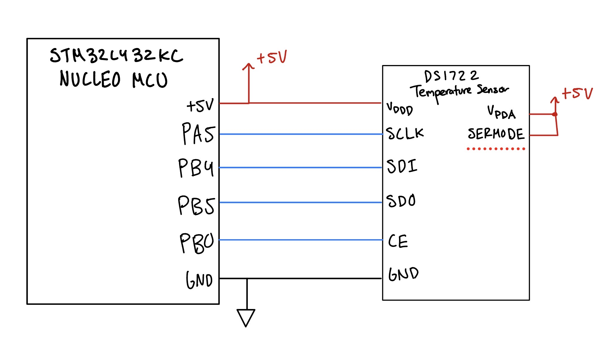
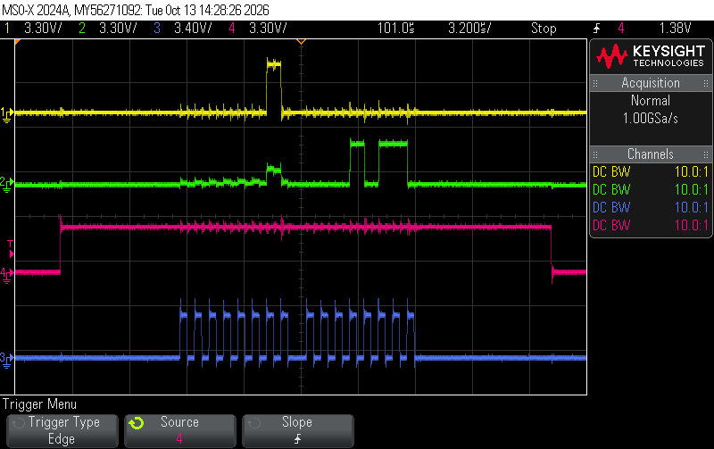

Joaquin Gonzalez-Salgado | jgonzalezsalgado@hmc.edu | October 12, 2026

## Introduction
In this lab, an internet-accessible IoT device was built around the [STM32L432KC MCU](https://os.mbed.com/platforms/ST-Nucleo-L432KC/), a DS1722 digital temperature sensor, and an ESP8266 WiFi module. The MCU communicates with the DS1722 over a custom SPI driver written directly against the CMSIS device templates (no third-party drivers), and with the ESP8266 over UART to host a webpage. The page lets a user view the current ambient temperature, toggle an external LED, and, for the excellence requirement, select the DS1722's conversion resolution (8 through 12 bits) directly from the browser.

## Design and Testing Methodology
### ESP8266 UART Protocol and Web Server
The ESP8266 is connected to the MCU over USART1 at 125,000 baud. Each time a browser loads the page, the ESP8266 sends the MCU a short request that names what the user clicked, ending in a newline. The main loop reads the request one character at a time until that newline arrives, then checks it for a known tag: ledon or ledoff sets the LED, and res8 through res12 changes the DS1722's resolution. Once the request has been handled, the temperature is read from the DS1722 over SPI and the webpage is sent back to the ESP8266 over the same UART.

## Technical Documentation

::: {.callout-note collapse="true"}
## Source Code
The source code for the project can be found in the associated [GitHub Repo](https://github.com/jgonzs/Microprocessor-Projects/tree/main/Lab6).
:::

### Schematic

*Lab 6 Wiring Schematic // Joaquin Gonzalez-Salgado // October 12, 2026*

::: {.callout-note collapse="true"}
## Expand to see Schematic
{#fig-schematic}
:::

@fig-schematic shows the wiring between the Nucleo-L432KC and the DS1722. The SPI clock is on PA5, PB4 is the MCU's data input (MISO) and PB5 is the MCU's data output (MOSI), and the chip enable is on PB0. The DS1722 is powered from the Nucleo's +5V pin on both VDDD and VDDA and shares a common ground with the MCU. SERMODE is tied to +5V, which selects the SPI interface instead of the 3-wire interface. The ESP8266 WiFi click module is not shown, as it was connected on the motherboard.

### Oscilloscope Trace

*Lab 6 SPI Oscilloscope Trace // Joaquin Gonzalez-Salgado // October 12, 2026*

::: {.callout-note collapse="true"}
## Expand to see Oscilloscope Trace
{#fig-scope}
:::

@fig-scope shows a full SPI read transaction captured on an oscilloscope, since no logic analyzer was available. Channel 4 (pink) is CE, which goes high at the start of the transaction and low at the end, as expected for the DS1722's active-high chip enable. Channel 3 (blue) is SCLK, which idles low and produces 16 clock pulses: 8 for the address byte and 8 for the data byte. Channel 1 (yellow) is the data from the MCU to the sensor, which carries the register address during the first byte, and channel 2 (green) is the data from the sensor back to the MCU, which carries the temperature reading during the second byte. The 16 clock pulses span about 12.8 µs, matching the 1.25 MHz SPI clock.

## Results and Discussion

::: {.callout-note}
## Results and Discussion
The design was a success!
:::

The design met all specifications. The webpage displays the current temperature read from the DS1722 and updates it when refreshed, shows the LED state and can toggle it, and lets the user select the sensor's resolution from 8 to 12 bits.

## Conclusion
This lab combined a from-scratch SPI driver for the DS1722 temperature sensor with a UART-based request/response protocol to the ESP8266, producing a webpage that reads live temperature, controls an LED, and changes the sensor's resolution over WiFi. The active-high CE of the DS1722, formatting the temperature without floating-point printf, and handling the stale reading after a resolution change were the main departures from a "textbook" SPI/UART implementation.

::: {.callout-note}
## Hours Spent on Lab
This lab took 12 hours.
:::


## AI Prototype Summary
The purpose of the AI Prototype is to experiment with utilizing AI as a coding assistant, and analyze the quality, speed, and precision that an LLM can generate code. The prompt for this week is shown below:

::: {.callout-tip}
## AI Prototype (Claude Sonnet)
**Prompt:** I'm writing a bare-metal SPI driver for a DS1722 temperature sensor on the STM32L432KC using CMSIS, no HAL. The DS1722's chip-enable line is active HIGH instead of the usual active-low chip select. How should that change my SPI transaction code compared to a normal active-low peripheral?
:::

::: {.callout-note collapse="true"}
## Generated Code:
```c
// Active-HIGH CE: assert CE HIGH to start, LOW to end — opposite of
// a normal active-low SPI chip select.

#define DS1722_WRITE_BIT 0x80

void ds1722_write_reg(uint8_t reg, uint8_t data) {
    digitalWrite(SPI_CE, PIO_HIGH);   // assert (opposite of CS-low parts)
    spiSendReceive(reg | DS1722_WRITE_BIT);
    spiSendReceive(data);
    digitalWrite(SPI_CE, PIO_LOW);    // deassert
}

uint16_t ds1722_read_temp_raw(void) {
    digitalWrite(SPI_CE, PIO_HIGH);
    spiSendReceive(0x01);             // LSB register address, read
    uint8_t lsb = spiSendReceive(0x00);
    uint8_t msb = spiSendReceive(0x00); // auto-increments to MSB reg
    digitalWrite(SPI_CE, PIO_LOW);
    return (msb << 8) | lsb;
}
```
:::

### Reflection:
This week is Claude Sonnet again. Its core advice was correct: since CE is active-high, every transaction simply swaps which level means "asserted," so the GPIO write at the start of a transaction drives CE high instead of low, and the one at the end drives it low instead of high. Everything else about clocking bytes out over SPI stays the same. It also suggested reading the LSB and MSB registers back-to-back in one CE-asserted burst to take advantage of the DS1722's register auto-increment, rather than doing two separate transactions.

Where it fell short was the temperature decode itself: it returned the raw register pair as a plain uint16_t and left interpreting the sign and fractional bits as an exercise, without mentioning that the MSB is signed two's-complement or that the LSB's upper nibble holds the fractional bits, worth 1/2 down to 1/16 of a degree. That part, including the negative-temperature edge case (-10.5 °C is stored as MSB = 0xF5 and LSB = 0x80), had to be worked out by hand from the datasheet.

::: {.callout-note collapse="true"}
## Generated Code: Website
```html
<!DOCTYPE html>
<html lang="en">
<head>
<meta charset="UTF-8">
<meta name="viewport" content="width=device-width, initial-scale=1.0">
<title>Temperature Monitor</title>

<style>
    * {
        box-sizing: border-box;
        margin: 0;
        padding: 0;
    }

    body {
        font-family: 'Inter', 'Segoe UI', sans-serif;
        background: #0b1120;
        color: #e5eaf3;
        min-height: 100vh;
        padding: 40px 20px;
    }

    .container {
        max-width: 1000px;
        margin: auto;
    }

    header {
        display: flex;
        justify-content: space-between;
        align-items: center;
        margin-bottom: 45px;
        flex-wrap: wrap;
        gap: 15px;
    }

    .brand {
        display: flex;
        align-items: center;
        gap: 12px;
    }

    .brand-icon {
        width: 44px;
        height: 44px;
        background: #1d4ed8;
        border-radius: 12px;
        display: grid;
        place-items: center;
        font-size: 23px;
    }

    h1 {
        font-size: 23px;
        font-weight: 650;
        letter-spacing: -0.5px;
    }

    .subtitle {
        color: #8492a9;
        font-size: 13px;
        margin-top: 4px;
    }

    .connection {
        display: flex;
        align-items: center;
        gap: 9px;
        background: #142033;
        border: 1px solid #25334a;
        padding: 10px 15px;
        border-radius: 30px;
        font-size: 13px;
        color: #a9b8ce;
    }

    .dot {
        width: 9px;
        height: 9px;
        border-radius: 50%;
        background: #22c55e;
        box-shadow: 0 0 10px #22c55e88;
    }

    .page-title {
        margin-bottom: 22px;
    }

    .page-title h2 {
        font-size: 28px;
        margin-bottom: 8px;
    }

    .page-title p {
        color: #8492a9;
        font-size: 14px;
    }

    .dashboard {
        display: grid;
        grid-template-columns: 1.5fr 1fr;
        gap: 20px;
    }

    .card {
        background: #131e30;
        border: 1px solid #26364e;
        border-radius: 18px;
        padding: 27px;
    }

    .card-header {
        display: flex;
        justify-content: space-between;
        align-items: center;
        margin-bottom: 30px;
    }

    .card-label {
        color: #9aaac1;
        font-size: 13px;
        font-weight: 600;
        letter-spacing: 1px;
        text-transform: uppercase;
    }

    .tag {
        background: #172d4c;
        color: #60a5fa;
        padding: 6px 10px;
        font-size: 11px;
        border-radius: 20px;
    }

    /* Temperature display */

    .temperature-card {
        min-height: 310px;
    }

    .temperature-display {
        display: flex;
        align-items: baseline;
        margin: 20px 0 10px;
    }

    #temperature {
        font-size: clamp(65px, 10vw, 105px);
        font-weight: 650;
        letter-spacing: -6px;
        color: #f1f5f9;
        line-height: 1;
    }

    .unit {
        font-size: 35px;
        color: #60a5fa;
        margin-left: 10px;
        font-weight: 400;
    }

    .temp-description {
        color: #8492a9;
        font-size: 14px;
        margin-top: 20px;
    }

    .temp-footer {
        border-top: 1px solid #26364e;
        margin-top: 30px;
        padding-top: 18px;
        display: flex;
        justify-content: space-between;
        color: #8492a9;
        font-size: 12px;
    }

    /* LED card */

    .led-card {
        display: flex;
        flex-direction: column;
    }

    .led-visual {
        flex: 1;
        display: flex;
        justify-content: center;
        align-items: center;
        min-height: 155px;
    }

    .led-bulb {
        width: 90px;
        height: 90px;
        border-radius: 50%;
        background: #263449;
        border: 7px solid #35445a;
        transition: all 0.3s ease;
    }

    .led-bulb.on {
        background: #facc15;
        border-color: #fde68a;
        box-shadow: 0 0 25px #facc1580,
                    0 0 60px #facc1540;
    }

    .led-status {
        text-align: center;
        font-size: 22px;
        font-weight: 600;
        margin-bottom: 8px;
    }

    .led-description {
        text-align: center;
        color: #8492a9;
        font-size: 13px;
        margin-bottom: 22px;
    }

    /* Toggle switch */

    .toggle-container {
        display: flex;
        justify-content: center;
        align-items: center;
        gap: 14px;
        margin-bottom: 5px;
    }

    .switch {
        position: relative;
        width: 58px;
        height: 31px;
        display: inline-block;
    }

    .switch input {
        opacity: 0;
        width: 0;
        height: 0;
    }

    .slider {
        position: absolute;
        inset: 0;
        background: #334155;
        border-radius: 30px;
        cursor: pointer;
        transition: 0.25s;
    }

    .slider:before {
        content: "";
        position: absolute;
        width: 23px;
        height: 23px;
        left: 4px;
        top: 4px;
        background: white;
        border-radius: 50%;
        transition: 0.25s;
    }

    input:checked + .slider {
        background: #2563eb;
    }

    input:checked + .slider:before {
        transform: translateX(27px);
    }

    /* Settings */

    .settings-card {
        grid-column: 1 / -1;
    }

    .settings-grid {
        display: grid;
        grid-template-columns: 1fr 1fr;
        gap: 25px;
    }

    .setting-item label {
        display: block;
        color: #d4deed;
        font-size: 14px;
        font-weight: 600;
        margin-bottom: 12px;
    }

    select {
        width: 100%;
        padding: 13px 15px;
        border: 1px solid #35465f;
        border-radius: 9px;
        background: #0e192a;
        color: #e5eaf3;
        font-size: 14px;
        outline: none;
        cursor: pointer;
    }

    select:focus {
        border-color: #3b82f6;
    }

    .setting-description {
        font-size: 12px;
        color: #8492a9;
        margin-top: 9px;
    }

    .refresh-button {
        background: #1d4ed8;
        border: none;
        color: white;
        padding: 13px 18px;
        border-radius: 9px;
        font-size: 13px;
        font-weight: 600;
        cursor: pointer;
        transition: 0.2s;
    }

    .refresh-button:hover {
        background: #2563eb;
    }

    footer {
        text-align: center;
        color: #52627a;
        font-size: 12px;
        margin-top: 35px;
    }

    @media(max-width: 700px) {
        .dashboard {
            grid-template-columns: 1fr;
        }

        .settings-card {
            grid-column: auto;
        }

        .settings-grid {
            grid-template-columns: 1fr;
        }

        header {
            margin-bottom: 30px;
        }

        .card {
            padding: 22px;
        }
    }
</style>
</head>

<body>
<div class="container">

    <header>
        <div class="brand">
            <div class="brand-icon">🌡</div>
            <div>
                <h1>ThermoLink</h1>
                <div class="subtitle">Temperature Monitoring System</div>
            </div>
        </div>

        <div class="connection">
            <span class="dot" id="connectionDot"></span>
            <span id="connectionStatus">Demo Mode</span>
        </div>
    </header>

    <div class="page-title">
        <h2>Dashboard</h2>
        <p>Monitor your sensor and control connected hardware.</p>
    </div>

    <main class="dashboard">

        <!-- Temperature -->
        <section class="card temperature-card">
            <div class="card-header">
                <span class="card-label">Current Temperature</span>
                <span class="tag">LIVE SENSOR</span>
            </div>

            <div class="temperature-display">
                <span id="temperature">24.50</span>
                <span class="unit">°C</span>
            </div>

            <div class="temp-description">
                Real-time temperature measurement
            </div>

            <div class="temp-footer">
                <span>Last updated</span>
                <span id="lastUpdated">--:--:--</span>
            </div>
        </section>

        <!-- LED Control -->
        <section class="card led-card">
            <div class="card-header">
                <span class="card-label">LED Control</span>
                <span class="tag">OUTPUT</span>
            </div>

            <div class="led-visual">
                <div class="led-bulb" id="ledBulb"></div>
            </div>

            <div class="led-status" id="ledStatus">LED OFF</div>

            <div class="led-description" id="ledDescription">
                The LED is currently disabled.
            </div>

            <div class="toggle-container">
                <span style="font-size:12px;color:#8492a9">OFF</span>

                <label class="switch">
                    <input type="checkbox" id="ledToggle">
                    <span class="slider"></span>
                </label>

                <span style="font-size:12px;color:#8492a9">ON</span>
            </div>
        </section>

        <!-- Settings -->
        <section class="card settings-card">
            <div class="card-header">
                <span class="card-label">Display Settings</span>
                <span class="tag">CONFIGURATION</span>
            </div>

            <div class="settings-grid">

                <div class="setting-item">
                    <label for="precision">Temperature Precision</label>

                    <select id="precision">
                        <option value="0">0 decimal places</option>
                        <option value="1">1 decimal place</option>
                        <option value="2" selected>2 decimal places</option>
                        <option value="3">3 decimal places</option>
                        <option value="4">4 decimal places</option>
                    </select>

                    <p class="setting-description">
                        Choose how many decimal places are displayed
                        in your temperature reading.
                    </p>
                </div>

                <div class="setting-item">
                    <label>Sensor Information</label>

                    <div style="padding:13px 15px;background:#0e192a;
                                border:1px solid #35465f;border-radius:9px;
                                font-size:14px;color:#a9b8ce">
                        DS1722 Digital Temperature Sensor
                    </div>

                    <p class="setting-description">
                        Connected through the STM32L432KC microcontroller.
                    </p>
                </div>

            </div>
        </section>

    </main>

    <footer>
        ThermoLink &nbsp; | &nbsp; Embedded Systems Monitoring Interface
    </footer>

</div>

<script>
    // ==========================================
    // CONFIGURATION
    // ==========================================

    const DEMO_MODE = true;
    const UPDATE_INTERVAL = 1000;

    let currentTemperature = 24.50;
    let ledState = false;

    const temperatureDisplay =
        document.getElementById("temperature");

    const precisionSelect =
        document.getElementById("precision");

    const ledToggle =
        document.getElementById("ledToggle");


    // ==========================================
    // TEMPERATURE DISPLAY
    // ==========================================

    function updateTemperatureDisplay(temp) {
        const precision = parseInt(precisionSelect.value);

        temperatureDisplay.textContent =
            temp.toFixed(precision);

        document.getElementById("lastUpdated")
            .textContent = new Date().toLocaleTimeString();
    }

    precisionSelect.addEventListener("change", () => {
        updateTemperatureDisplay(currentTemperature);
    });


    // ==========================================
    // LED CONTROL
    // ==========================================

    async function setLED(state) {

        if (!DEMO_MODE) {
            // Replace with your STM32 backend endpoint.
            const response = await fetch("/api/led", {
                method: "POST",
                headers: {
                    "Content-Type": "application/json"
                },
                body: JSON.stringify({ state: state })
            });

            if (!response.ok) {
                throw new Error("Failed to update LED");
            }
        }

        ledState = state;
        updateLEDDisplay();
    }

    function updateLEDDisplay() {
        const bulb = document.getElementById("ledBulb");
        const status = document.getElementById("ledStatus");
        const description =
            document.getElementById("ledDescription");

        bulb.classList.toggle("on", ledState);

        status.textContent = ledState ? "LED ON" : "LED OFF";

        description.textContent = ledState
            ? "The LED is currently illuminated."
            : "The LED is currently disabled.";
    }

    ledToggle.addEventListener("change", async () => {
        ledToggle.disabled = true;

        try {
            await setLED(ledToggle.checked);
        } catch (error) {
            ledToggle.checked = ledState;
            alert("Unable to communicate with the LED.");
        } finally {
            ledToggle.disabled = false;
        }
    });


    // ==========================================
    // SENSOR COMMUNICATION
    // ==========================================

    async function getTemperature() {

        if (DEMO_MODE) {
            // Simulated temperature fluctuation.
            currentTemperature +=
                (Math.random() - 0.5) * 0.15;

            currentTemperature = Math.max(
                15,
                Math.min(35, currentTemperature)
            );

        } else {
            // Replace with your STM32 backend endpoint.
            const response = await fetch("/api/temperature");

            if (!response.ok) {
                throw new Error("Sensor communication failed");
            }

            const data = await response.json();

            // Expected JSON: { "temperature": 24.50 }
            currentTemperature = data.temperature;
        }

        updateTemperatureDisplay(currentTemperature);
    }


    // ==========================================
    // CONNECTION STATUS
    // ==========================================

    function setConnectionStatus(connected) {
        const status =
            document.getElementById("connectionStatus");

        const dot =
            document.getElementById("connectionDot");

        status.textContent = connected
            ? (DEMO_MODE ? "Demo Mode" : "Connected")
            : "Disconnected";

        dot.style.background =
            connected ? "#22c55e" : "#ef4444";

        dot.style.boxShadow = connected
            ? "0 0 10px #22c55e88"
            : "0 0 10px #ef444488";
    }


    // ==========================================
    // MAIN UPDATE LOOP
    // ==========================================

    async function refresh() {
        try {
            await getTemperature();
            setConnectionStatus(true);
        } catch (error) {
            console.error(error);
            setConnectionStatus(false);
        }
    }

    // Initial setup
    updateLEDDisplay();
    refresh();

    // Periodically retrieve sensor readings
    setInterval(refresh, UPDATE_INTERVAL);

</script>

</body>
</html>
```
:::

### Reflection:
ChatGPT gave out a Python Flask Backend? And an STM UART command. A little overdone.

Now for embedded C:

::: {.callout-note collapse="true"}
## Generated Code: Embedded C
```c
#include "stm32l432xx.h"
#include <stdint.h>
#include <stdbool.h>

// =============================================
// DS1722 DEFINITIONS
// =============================================

#define DS1722_SPI          SPI1

#define DS1722_CE_HIGH()    (GPIOA->BSRR = (1U << 4))
#define DS1722_CE_LOW()     (GPIOA->BSRR = (1U << (4 + 16)))

#define DS1722_READ_TEMP_LSB    0x01U
#define DS1722_WRITE_CONFIG     0x80U

// 12-bit resolution, continuous conversion mode
#define DS1722_CONFIG_12BIT     0x40U

#define SPI_TIMEOUT             100000U


// =============================================
// SMALL TIMING DELAY
// =============================================

static void DS1722_Delay(void)
{
    for (volatile uint32_t i = 0; i < 50U; i++)
    {
        __NOP();
    }
}


// =============================================
// SPI1 INITIALIZATION
// =============================================

void DS1722_SPI_Init(void)
{
    // Enable GPIOA and SPI1 clocks
    RCC->AHB2ENR |= RCC_AHB2ENR_GPIOAEN;
    RCC->APB2ENR |= RCC_APB2ENR_SPI1EN;

    // PA4: GPIO output (CE)
    // PA5, PA6, PA7: Alternate function (SPI1)

    GPIOA->MODER &= ~(
        (3U << (4U * 2U)) |
        (3U << (5U * 2U)) |
        (3U << (6U * 2U)) |
        (3U << (7U * 2U))
    );

    GPIOA->MODER |=
        (1U << (4U * 2U)) |
        (2U << (5U * 2U)) |
        (2U << (6U * 2U)) |
        (2U << (7U * 2U));

    // Configure PA5, PA6, PA7 for AF5 (SPI1)
    GPIOA->AFR[0] &= ~(
        (0xFU << (5U * 4U)) |
        (0xFU << (6U * 4U)) |
        (0xFU << (7U * 4U))
    );

    GPIOA->AFR[0] |=
        (5U << (5U * 4U)) |
        (5U << (6U * 4U)) |
        (5U << (7U * 4U));

    // Configure GPIO output speed
    GPIOA->OSPEEDR |=
        (3U << (4U * 2U)) |
        (3U << (5U * 2U)) |
        (3U << (6U * 2U)) |
        (3U << (7U * 2U));

    // No pull-up or pull-down
    GPIOA->PUPDR &= ~(
        (3U << (4U * 2U)) |
        (3U << (5U * 2U)) |
        (3U << (6U * 2U)) |
        (3U << (7U * 2U))
    );

    // CE initially LOW (inactive)
    DS1722_CE_LOW();

    // Disable SPI before configuring
    DS1722_SPI->CR1 = 0U;
    DS1722_SPI->CR2 = 0U;

    // Configure SPI:
    // Master mode
    // CPOL = 0
    // CPHA = 1 (SPI Mode 1)
    // Software NSS management
    // Baud rate = PCLK2 / 32

    DS1722_SPI->CR1 =
        SPI_CR1_MSTR |
        SPI_CR1_CPHA |
        SPI_CR1_SSM |
        SPI_CR1_SSI |
        SPI_CR1_BR_2;

    // 8-bit data size and 8-bit RX FIFO threshold
    DS1722_SPI->CR2 =
        (7U << 8U) |
        (1U << 12U);

    // Enable SPI
    DS1722_SPI->CR1 |= SPI_CR1_SPE;
}


// =============================================
// SPI BYTE TRANSFER
// =============================================

static bool DS1722_SPI_Transfer(
    uint8_t tx_data,
    uint8_t *rx_data
)
{
    uint32_t timeout = SPI_TIMEOUT;

    // Wait for transmit buffer to become empty
    while (!(DS1722_SPI->SR & SPI_SR_TXE))
    {
        if (--timeout == 0U)
            return false;
    }

    // Transmit one byte
    *(__IO uint8_t *)&DS1722_SPI->DR = tx_data;

    timeout = SPI_TIMEOUT;

    // Wait for received byte
    while (!(DS1722_SPI->SR & SPI_SR_RXNE))
    {
        if (--timeout == 0U)
            return false;
    }

    // Read received byte
    *rx_data = *(__IO uint8_t *)&DS1722_SPI->DR;

    return true;
}


// =============================================
// DS1722 CONFIGURATION
// =============================================

bool DS1722_Init(void)
{
    uint8_t dummy;

    // Enable communication
    DS1722_CE_HIGH();
    DS1722_Delay();

    // Write configuration register
    // Address 0x80 = write configuration register
    if (!DS1722_SPI_Transfer(DS1722_WRITE_CONFIG, &dummy))
    {
        DS1722_CE_LOW();
        return false;
    }

    // Set 12-bit resolution and continuous conversion
    if (!DS1722_SPI_Transfer(DS1722_CONFIG_12BIT, &dummy))
    {
        DS1722_CE_LOW();
        return false;
    }

    // Wait for last SPI transfer to finish
    while (DS1722_SPI->SR & SPI_SR_BSY);

    DS1722_Delay();
    DS1722_CE_LOW();

    // Allow first 12-bit conversion to complete.
    // Maximum conversion time is 1.2 seconds.
    return true;
}


// =============================================
// READ TEMPERATURE
// =============================================

bool DS1722_ReadTemperature(float *temperature)
{
    uint8_t dummy;
    uint8_t temp_lsb;
    uint8_t temp_msb;

    if (temperature == 0)
        return false;

    // Start SPI transaction
    DS1722_CE_HIGH();
    DS1722_Delay();

    // Send temperature LSB read address
    if (!DS1722_SPI_Transfer(
            DS1722_READ_TEMP_LSB, &dummy))
    {
        DS1722_CE_LOW();
        return false;
    }

    // Read temperature LSB
    // Sending dummy bytes generates the SPI clock
    if (!DS1722_SPI_Transfer(0xFFU, &temp_lsb))
    {
        DS1722_CE_LOW();
        return false;
    }

    // Read temperature MSB
    // DS1722 automatically increments register address
    if (!DS1722_SPI_Transfer(0xFFU, &temp_msb))
    {
        DS1722_CE_LOW();
        return false;
    }

    // Wait until SPI transmission is complete
    uint32_t timeout = SPI_TIMEOUT;

    while (DS1722_SPI->SR & SPI_SR_BSY)
    {
        if (--timeout == 0U)
        {
            DS1722_CE_LOW();
            return false;
        }
    }

    // End SPI transaction
    DS1722_Delay();
    DS1722_CE_LOW();

    // Combine temperature bytes
    // DS1722 uses 16-bit two's complement format
    int16_t raw_temperature =
        (int16_t)(((uint16_t)temp_msb << 8U) | temp_lsb);

    // Convert to degrees Celsius
    // 1 LSB = 1/256 degrees Celsius
    *temperature = (float)raw_temperature / 256.0f;

    return true;
}
```
:::

In my opinion, the Embedded C option was more friendlty to the platform, not calling on additional setup like Javascript or a Python Software to run, but I think given those things web devleopment code looks less convincing.